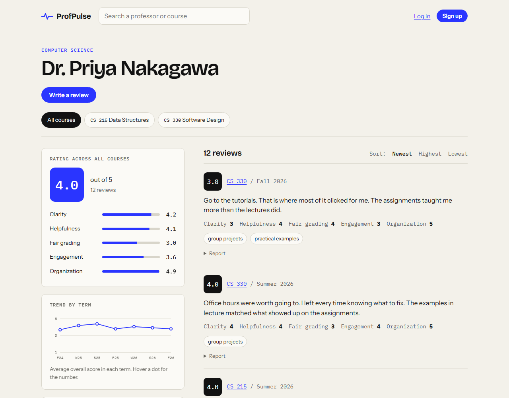

# ProfPulse

Professor ratings that are tied to a course.

On most rating sites a professor has one score. ProfPulse stores every review against a professor **and** a course, so you can see how someone teaches the class you are about to take, and compare everyone who teaches it.

Built with Flask, SQLite, and plain HTML, CSS and JavaScript. No front-end framework.

**Live demo:** https://profpulse.onrender.com (free host: the first visit after a quiet spell takes about a minute, and the made-up data resets when it restarts).



## What works

| Feature | Where to look |
| --- | --- |
| Five-category rating (clarity, helpfulness, fair grading, engagement, organization) | `profpulse/config.py`, `profpulse/schema.sql` |
| Ratings per course, and a course page that ranks everyone who teaches it | `profpulse/stats.py`, `/courses/CS 110` |
| Search by name, department, course code or course title, with live results as you type | `profpulse/stats.py`, `profpulse/static/js/search.js` |
| Tag-based filtering: a tag cloud per professor, and a tag filter on search | `profpulse/browse.py`, `profpulse/templates/professor.html` |
| Trend by term, drawn as a small chart with no chart library | `stats.trend_chart()` |
| Accounts limited to one school email domain, with a verification link | `profpulse/auth.py` |
| Review form with server-side checks, one review per course per term | `profpulse/reviews.py` |
| Reporting: a review is hidden after three different students report it | `profpulse/reviews.py` |
| 36 automated tests | `tests/` |

## What does not work yet

- **No real email is sent.** The verification link is written to `instance/outbox.txt` and, in development, shown on the page after sign-up. Connecting a mail service means replacing one function, `_send_verification_email` in `profpulse/auth.py`.
- **The demo forgets new reviews.** On the free host the disk is wiped on each restart, so the sample data is rebuilt and anything posted there disappears.
- **The data is made up.** Every professor, course and review comes from `profpulse/seed.py`. Nothing was copied from another site.
- **There is no admin page.** Reported reviews are hidden automatically, but nobody can review the reports or add a professor through the site.
- **The Sprint 0 prototype is not in this repository yet.** See `prototype/README.md`.

## Run it

You need Python 3.10 or newer.

Windows (PowerShell):

```
python -m venv .venv
.venv\Scripts\Activate.ps1
pip install -r requirements.txt
python run.py
```

macOS or Linux:

```
python3 -m venv .venv
source .venv/bin/activate
pip install -r requirements.txt
python run.py
```

Then open http://127.0.0.1:5000. The first run creates the database and fills it with the sample data.

To try posting a review: sign up with any address ending in `@uoguelph.ca`, open the link shown on the next page, log in, and pick a professor.

To start again from clean data, delete the `instance` folder and run it again.

## Run the tests

```
pytest
```

Each test builds its own temporary database, so the tests never touch your real one.

## Deploying

`render.yaml` holds the settings for [Render](https://render.com), where the live demo runs. It is set up as a Blueprint from the public repository URL, so a push does not redeploy by itself: use **Manual Deploy** on the service in the Render dashboard, or connect the GitHub account there to deploy on every push.

Three environment variables matter on a host:

- `PROFPULSE_SECRET_KEY`: the key that signs the session cookie. Render generates it.
- `PROFPULSE_BEHIND_PROXY=1`: trust the host's proxy for the visitor's address and https, so rate limits work per visitor.
- `PROFPULSE_SHOW_VERIFY_LINK=1`: show the verification link on the page, because no email service is connected yet.

## How it is put together

```
run.py                  starts the app, creates the database on first run
profpulse/
  __init__.py           builds the Flask app, security headers, error pages
  config.py             the school, the five categories, the tags, the limits
  schema.sql            the database tables
  db.py                 opening and closing the database connection
  seed.py               the made-up sample data
  security.py           logged-in user, CSRF tokens, access checks, rate limits
  auth.py               sign up, verify email, log in, log out
  browse.py             the public pages and the live-search endpoint
  reviews.py            posting and reporting reviews
  stats.py              the SQL behind averages, tags, trends and search
  templates/            the HTML pages (Jinja)
  static/               the stylesheet, two small scripts, the fonts
tests/                  pytest tests
docs/                   user stories, backlog, sprint plan, design notes
prototype/              the Sprint 0 front-end prototype
```

The design choices, and the reasons for them, are in [docs/design.md](docs/design.md).

## Security

A rating site takes input from strangers, so these were built in from the start:

- **SQL injection:** every query passes values as `?` parameters. User input is never joined into SQL text.
- **Passwords:** stored as salted scrypt hashes, never as text.
- **Cross-site scripting:** Jinja escapes everything it prints, the live search uses `textContent`, and a content security policy only allows scripts from this site.
- **CSRF:** every form carries a per-session token, checked on every POST.
- **Email verification:** the token is random, expires after 24 hours, works once, and only its hash is stored.
- **Account enumeration:** sign-up and login give the same answer whether or not an email has an account.
- **Abuse:** rate limits on login, sign-up, reviews and reports. Tags come from a fixed list.
- **Open redirects:** after login, the app only redirects to its own pages.

## Changing things

- **The school or email domain:** `SCHOOL_NAME` and `SCHOOL_EMAIL_DOMAIN` in `profpulse/config.py`.
- **A category name:** change its label in `CATEGORIES` in `profpulse/config.py`.
- **A whole category:** change its key in `CATEGORIES` and the matching column in `profpulse/schema.sql`, then delete the `instance` folder.
- **The tags, the terms, the limits:** `profpulse/config.py`.
- **The colours and fonts:** the variables at the top of `profpulse/static/css/style.css`.
- **The sample data:** `profpulse/seed.py`.

## Process

The project is run with Scrum: user stories, a product backlog, and sprints. See [docs/user-stories.md](docs/user-stories.md), [docs/backlog.md](docs/backlog.md) and [docs/sprints.md](docs/sprints.md).

## Fonts

Bricolage Grotesque, Instrument Sans and IBM Plex Mono, served from this repository under the SIL Open Font License. The licence files sit beside the fonts in `profpulse/static/fonts`.
